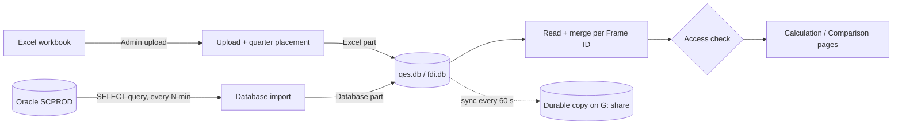

# Proactive Reporting — How it works

Architecture, data extraction and access rules of the QES / FDI calculation and comparison tool. Last updated 2026-10-27.

---

## 1. Overview

A web application that SCAD auditors, enumerators, supervisors and admins open in the browser. For each establishment (Frame ID) it:

- **calculates** the survey figures for each quarter: QES Total production, Intermediate consumption, Added value, Profit and compensation checks; the FDI asset equation and equity checks;
- **compares** quarters side by side, with red/green trends, validation flags and charts;
- **restricts** each user to the Frame IDs assigned to them.

Survey data comes from two sources:

| Source | What it holds | How it gets in |
|---|---|---|
| **Excel upload** | Earlier quarters (and any columns the database does not return) | Admin → upload a workbook, once per data refresh |
| **Database (Oracle / SQL Server)** | The current quarter, live | Admin → Database connection: one SELECT query per survey, re-run automatically every N minutes |

---

## 2. Components

| Layer | Technology | Where |
|---|---|---|
| Web server | Python **FastAPI** served by **uvicorn** (`python run.py`, port 8000) | `run.py`, `app/app.py` |
| Pages | Server-rendered **Jinja2** templates, English / Arabic | `app/templates/`, `app/i18n.py` |
| Charts | Plain SVG drawn in the browser, no external library | `app/static/charts.js`, `barchart.js` |
| Storage | **SQLite** files | `data/*.db` |
| Excel reading | **openpyxl** | `app/excel_utils.py` |
| Database drivers | **python-oracledb** (Oracle), **pyodbc** (SQL Server). Only loaded when a connection is used | `app/db_import.py` |
| Calculations | Pure Python | `app/calculations_qes.py`, `app/calculations_fdi.py`, `app/calc_common.py` |
| Access control | Pure Python | `app/auth.py` |

The code lives in the shared folder `G:\proactive_reporting_app` and runs on one server machine. **Python code and templates are loaded when the server starts:** after any code change, restart the app.

### Main modules

| Module | Responsibility |
|---|---|
| `app/app.py` | Every page and admin action (routes), search, licence grouping, dashboard |
| `app/auth.py` | Sign-in, sessions, who can open which Frame ID |
| `app/database.py` | SQLite storage, local / durable copies, the Excel and database parts of each survey |
| `app/excel_utils.py` | Reading workbooks, finding the header row, placing quarter blocks |
| `app/db_import.py` | Database connection, queries, import, change counts, auto-refresh |
| `app/calculations_qes.py`, `calculations_fdi.py` | The survey formulas and checks |
| `app/survey_layouts.py` | The exact QES / FDI column lists (20-10 variable list) |
| `app/variable_reference.py`, `logs_export.py` | Admin Excel downloads: variable reference, activity log, users |

### Pages

| Page | Route | Who |
|---|---|---|
| Sign in / out | `/login`, `/logout` | everyone |
| Home | `/dashboard` | signed-in users: their current-quarter Frame IDs (supervisors and admins: all assigned) |
| Calculation | `/survey/qes`, `/survey/fdi` | Frame IDs the user can open |
| Comparison | `/compare/qes`, `/compare/fdi` | Frame IDs the user can open |
| Guide | `/guide` | everyone |
| Admin | `/admin` and `/admin/...` | **ADMIN only**: uploads, users, controller teams, database connection, activity log, exports |

Old FISQ links (`/survey/fisq`, `/compare/fisq`) redirect to FDI.

---

## 3. Storage

### Databases (`data/` folder, not in git)

| File | Contents |
|---|---|
| `main.db` | `users` (accounts, roles, suspended flag), `logs` (activity log), `settings` (database connection, queries, import status), `controller_members` (controller teams) |
| `qes.db`, `fdi.db` | One `records` table each: `frame_id`, `source_file`, `uploaded_at`, `data` (all columns of one row as JSON) |
| `aes.db`, `fis.db` | Annual ISIC codes (`{YYYY}_ISIC4`) for the ISIC cross-check on the comparison pages |

### Two copies of every database

SQLite cannot write reliably over a network share, so every database exists twice:

1. a **local working copy** on the server machine (`%LOCALAPPDATA%\ProactiveReporting\data`), which every read and write goes through;
2. a **durable copy** in `G:\proactive_reporting_app\data`. It's copied to the local disk at startup when the local copy is missing, and synced back every 60 seconds and at shutdown.

If the server machine is reset, the next start restores the local copy from the durable one, so at most the last minute of activity is at risk.

### The Excel part and the database part

Each survey's `records` table holds two independent parts, told apart by `source_file`:

| Part | `source_file` | Replaced by |
|---|---|---|
| Excel part | the workbook name, e.g. `qes test 1.xlsx` | an Excel upload (while a query is saved, only this part) |
| Database part | starts with `Database: `, e.g. `Database: Oracle host:1530/SERVICE` | a database import (only this part) |

---

## 4. Data extraction

### 4.1 Excel upload (Admin → upload)

1. **Choose file and sheet.** The admin uploads a workbook and picks one sheet (or all sheets).
2. **Find the header row.** The first row containing a Frame ID-like heading (`FRAME_ID`, `FRAMEID`, `رقم الإطار`, …) is the header, so title rows above the table are ignored.
3. **One record per row**, keyed by its Frame ID; rows without a Frame ID are skipped.
4. **Place each quarter's columns** (`QuarterLayout`). A file merged from several quarterly extracts has one block of `Q#_YYYY_` columns per extract. Repeated blocks arrive as `Right_Q2_2026_…` / `Right_Right_Q2_2026_…`, and loose columns such as `Right_Licence_Number` sit inside them. Each block is placed in the quarter its **own YEAR / QUARTER values** name, record by record. Every column ends up under a plain prefix such as `Q3_2026_Total_Revenue`. The upload message lists how blocks were placed.
5. **Store.** The records replace the survey's Excel part.

### 4.2 Database import (Admin → Database connection)

**Connection.** The admin enters the JDBC URL from the database team, a username and a password:

| URL | Driver used |
|---|---|
| `jdbc:oracle:thin:@//host:port/SERVICE` (or `@host:port:SID`, `@(DESCRIPTION=…)`) | python-oracledb, thin mode; falls back to the installed Oracle Client |
| `jdbc:sqlserver://host:1433;databaseName=DB` | pyodbc with the installed SQL Server ODBC driver |

No Java runtime is needed. The password is kept in `main.db` (local to the server, never in git); a blank password on save keeps the stored one.

**Queries.** One `SELECT` per dataset (QES, FDI; optionally AES, FIS):

- **Read-only:** only `SELECT` / `WITH` statements run, nothing is committed, and every connection is rolled back and closed. Each query has a 15-second time limit.
- **Test query / Preview** run the query without loading it, and list any columns the pages need that the query does not return.

**Steps of an import:**

1. **Fetch** all rows of the query.
2. **Assign the quarter.** If the columns have no `Q#_YYYY_` prefix (the usual case), every column except the Frame ID gets the prefix of the quarter chosen in **"Quarter of the query columns"**. The default is the latest ended quarter: Q3_2026 from October to December 2026. With *"Each row's own YEAR / QUARTER"*, each row goes to the quarter its YEAR and QUARTER columns name instead.
   > The query's own YEAR / QUARTER values are **ignored** unless that option is chosen, so make sure the query reads the table for the quarter chosen.
3. **Match column names** to the Excel names (`to_excel_names`), e.g. `MAIN_REVENUE` → `Total_Revenue`, `LIC_NO` → `Licence_Number`, `CURR_AS_Q3_TOTAL` → `Total_of_Current_Assets`. The database value then replaces the Excel value for the same field, instead of standing beside it.
4. **Detect changes.** If the data is identical to the last import, nothing is rewritten: *"no changes since the last import (630 records, 0 updated)"*. Otherwise the new rows are compared with the stored ones per Frame ID: **updated** (any value changed), **new** and **removed**.
5. **Store.** The rows replace the survey's database part; the Excel part is untouched.
6. **Report.** The status line on the Admin page shows, e.g., *"QES: 630 records imported (12 updated, 0 new, 0 removed)"*. Imports that changed something are recorded in the activity log with the changed Frame IDs (up to 30 of each kind). Unchanged automatic runs are not logged.

**Auto-refresh.** With *auto-refresh minutes* above 0, every dataset that has a query is re-imported on that interval. The setting is checked every 30 seconds, so changes take effect without a restart. Each run sends the full queries to the database, so choose the interval with the database's load in mind.

### 4.3 How a page reads the data

1. **Load.** `all_records` reads a survey's records once and keeps them in memory until the file changes (after an upload or an import that changed something).
2. **Order.** Database-part records come after Excel-part records.
3. **The database quarter comes from the database only.** For the quarter the database part holds (Q3 2026 now), the Excel upload's columns are dropped, so its figures come **only** from the database. A Frame ID the database doesn't return shows no figures for that quarter. Two kinds of Excel columns for that quarter are kept, because they are not figures:
   - the **assignment** columns (auditor, enumerator and supervisor usernames and names), because the queries return no usernames and access follows them;
   - the **licence number**, which groups Frame IDs.

   Earlier quarters (Q4 2025 – Q2 2026) come only from Excel. Without a database import, Excel supplies every quarter.
4. **Merge per Frame ID.** A Frame ID's records are merged in that order.
5. **Licence group.** A page for one Frame ID also includes every other Frame ID that shares **any licence number** with it, from any quarter (one establishment can carry two). The user must be allowed to open the Frame ID they searched; the other Frame IDs then come along even when they aren't assigned to the user, which is how a database view that files the current quarter under an older Frame ID reaches the current one. Each quarter is taken whole from the Frame ID that reported the most figures for it, and the page notes where each quarter came from.
6. **Calculate** each quarter with the survey's formulas (see `docs/Calculations_and_Comparisons_Reference.md`).

---

## 5. Access control

### Roles (account *Authorization*)

| Role | Opens | Home page lists | Admin pages |
|---|---|---|---|
| **ADMIN** | every Frame ID | all Frame IDs assigned in the current quarter | yes |
| **SUPERVISOR** | every Frame ID | all Frame IDs assigned in the current quarter | no |
| **CONTROLLER** | Frame IDs assigned to the employees an admin placed in their team | their team's, per employee | no |
| **USER** | only Frame IDs assigned to them in the current quarter | their own | no |

A **suspended** account cannot sign in, and is signed out on its next click. Role changes apply on the user's next click.

### How a Frame ID is matched to a user

- **Current quarter:** the newest quarter in that survey's data (Q3 2026 now). A Frame ID belongs to whoever is assigned to it **in that quarter**. Once it's yours, all its quarters (its history) come with it.
- **Assignment columns:** any of `Auditor_User_Name`, `ENUMERATOR_User_name`, `AUD_Supervisor_USER_Name`, `ENU_Supervisor_User_Name` (usernames), or `AUDITOR_NAME_*`, `ENUMERATOR_NAME_*` (full names).
- **Matched on:** the account's username and account name, exactly. Similar usernames never match each other.
- **Blank usernames:** when a quarter leaves the username blank but fills in the full name, the app recognises the person from the name. It learns which username goes with which full name from records where both appear. A name counts only if it was seen with the same username at least twice and never with a different one.
- **Supervisor columns hold usernames only.** If a data source has no supervisor username columns, supervisors assigned in the data cannot be matched (SUPERVISOR accounts still see everything).

### Sign-in and sessions

Sessions are signed cookies (`SessionMiddleware`). The signing key comes from the `SESSION_SECRET_KEY` environment variable, or `data/session_secret.txt`, generated once. Every sign-in, page view, upload, import, download and refused access is written to the activity log with the user, role and IP address.

**Known limitation:** account passwords are stored and compared as plain text in `main.db`. Hashing them (e.g. bcrypt) is recommended before wider use.

---

## 6. Operations

| Task | How |
|---|---|
| Start the app | `python run.py` on the server machine (port 8000) |
| Apply a code change | Restart the app; Python and templates load at start-up |
| Python packages | `pip install -r requirements.txt`. `oracledb` / `pyodbc` are only needed for the database connection |
| Load earlier quarters | Admin → upload the Excel workbook (replaces the Excel part only) |
| Load the current quarter | Admin → Database connection: query, Test query, Import; set auto-refresh minutes |
| Check what changed | Admin → status line per dataset; Action logs (`QES_DB_IMPORTED`, `FDI_DB_IMPORTED`) |
| Exports | Admin → full activity log, users, variable reference (.xlsx) |
| Change history | `docs/CHANGELOG.md` |

---

## 7. Verification and current state (2026-10-27)

Run on copies of the live databases, without touching the live data.

**Pages and access: all passed**

- **Every Frame ID opens without errors:** 1,268 QES and 392 FDI Frame IDs, both the Calculation and the Comparison page of each (3,320 pages), as an admin.
- **Every user in the Frame ID distribution list** can open every Frame ID listed for them, and each of those pages loads.
- **All 9 SUPERVISOR accounts** can open exactly the same Frame IDs as an admin; nobody else's access changed.

**Where the Q3 2026 figures come from** (each Frame ID's page, admin view), since Q3 is taken from the database only:

| Source of the Q3 figures | QES | FDI |
|---|---|---|
| Database import (same Frame ID, or another with the same licence number) | 1,117 | 305 |
| Excel upload | 0 | 0 |
| No Q3 figures (the database has no row for it) | 151 | 87 |
| **Total Frame IDs** | **1,268** | **392** |

Switching Q3 to database-only changed only the Q3 figures of the 300 QES and 31 FDI Frame IDs that had Q3 in Excel. No earlier quarter changed, and nobody's access changed. On the distribution list's own Frame IDs, as each user sees them, Q3 has figures for 254 of 593 QES and 60 of 161 FDI.

**Open issue: the database queries read the Q1 2026 tables.** The QES query reads `AES17.VW_QESIB_Q1_DATA_26` and the FDI query `AES17.FIS_2026QRTR_1_SR_DATA_ALL`. The import labels their rows Q3 2026 (the quarter setting), but:

- the QES rows' own YEAR / QUARTER say 2026 / Q1;
- their figures and auditors equal the Excel **Q1 2026** values (e.g. 147 employees, compensation 3,114,849 for licence IN-1001310);
- they use the older Frame IDs, none of which is in the current Q3 distribution (0 of 593 QES, 0 of 161 FDI).

So the database figures above are Q1 figures shown as Q3. Admins and supervisors see them, but users don't, because those Frame IDs are not assigned to anyone in Q3. **To fix:** point both queries at the tables holding the current Q3 data with the current Frame IDs, keep the quarter setting on Q3_2026, then Test query and Import. Users then see their own Q3 figures, refreshed automatically.
